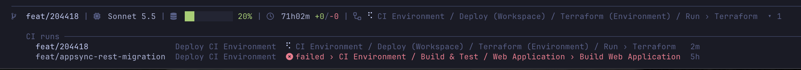

# Visor

A heads up display for Claude Code. Visor draws a status line under the prompt:



- branch, model and context usage
- session time and lines changed
- GitHub Actions status for the branch

Click the CI section or run `/visor ci` to see CI on your other branches.

## Requirements

- A Claude Code build with hooks modules (tested on 2.1.289)
- A [Nerd Font](https://www.nerdfonts.com/) in your terminal, for the icons. Without one they show as empty boxes. On macOS: `brew install --cask font-jetbrains-mono-nerd-font`, then select it in your terminal's settings.
- The [GitHub CLI](https://cli.github.com/), signed in with `gh auth login`. Only needed for the GitHub Actions section.

## Install

In Claude Code:

```
/plugin marketplace add json-born/visor
/plugin install visor@visor
```

## Configuration

Run `/plugin configure visor`, or set options from the shell:

```sh
echo '{"mainBranch":"main","githubActionsMainWorkflow":"Pipeline","githubActionsBranchWorkflow":"PR Validation"}' \
  | claude plugin configure visor --values-stdin
```

| Option | Description |
| --- | --- |
| `theme` | `Tokyo Night` (default) or `Catppuccin Mocha` |
| `mainBranch` | The branch that uses the main workflow, e.g. `main` |
| `githubActionsMainWorkflow` | The workflow that runs on pushes to `mainBranch` |
| `githubActionsBranchWorkflow` | The workflow that runs on every other branch |

Workflow names are passed to `gh run list --workflow`, so use the workflow's name or its file name (e.g. `ci.yml`). The GitHub Actions section stays hidden until a workflow is set for the current branch.

## Development

```sh
npm install
npm run check      # lint and format with Biome
npm run typecheck  # tsc, once Claude Code has written .claude-plugin/types
npm test
```

To try your local copy, run `claude --plugin-dir .` from the repo root.

## Licence

[MIT](LICENSE)
